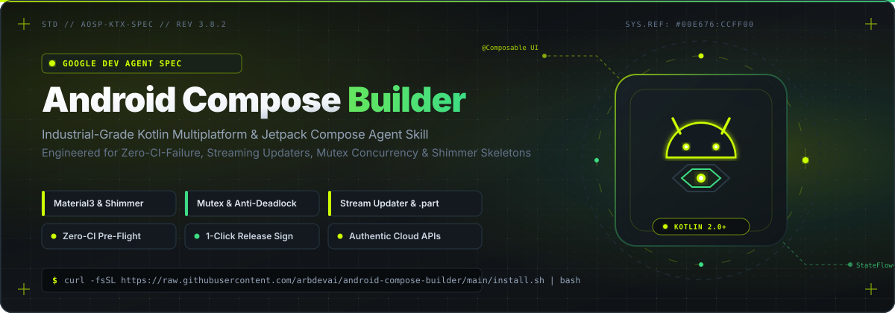

<p align="center">
  
</p>

<p align="center">
  <a href="LICENSE"></a>
  <a href="https://developer.android.com/jetpack/compose"></a>
  <a href="https://kotlinlang.org/"></a>
  <a href="#multi-cli-compatibility"></a>
  <a href="https://github.com/arbdevai/android-compose-builder/actions"></a>
</p>

---

##  Ikhtisar &amp; Standar Rekayasa

**Android Compose Builder** adalah spesifikasi standar rekayasa agen (*Agent Engineering Standard*) resmi untuk merancang, membangun, dan memelihara aplikasi Android modern berbasis **Kotlin + Jetpack Compose Material 3**. 

Dirancang dengan prinsip arsitektur tingkat industri Google Developer, skill ini memandu asisten coding AI (**Google Antigravity CLI**, **Claude Code**, **OpenAI Codex CLI**, **Cursor**, **Copilot**) agar menghasilkan kode yang andal, hemat memori, lolos verifikasi CI, dan siap pakai tanpa intervensi manual berulang.

---

##  Instalasi Cepat (1-Line Auto-Detect)

Jalankan perintah berikut di terminal untuk memasang atau memperbarui skill ini secara otomatis:

```bash
curl -fsSL https://raw.githubusercontent.com/arbdevai/android-compose-builder/main/install.sh | bash
```

> **Mekanisme Otomatis:** Skrip installer secara cerdas memindai CLI yang terpasang di sistem (`agy`, `claude`, `codex`) dan mengaitkan symlink *live-sync* langsung ke direktori konfigurasi masing-masing agent.

---

##  Pilar Arsitektur &amp; Prinsip Rekayasa

Skill ini menetapkan 9 aturan ketat yang wajib dipatuhi oleh setiap AI agent:

### 1. Skeleton Screen & Shimmer Native (Anti-Spinner Kosong)
- **Larangan:** Dilarang menampilkan `CircularProgressIndicator` di tengah layar kosong saat transisi data.
- **Standar:** Wajib menggunakan layout skeleton yang menyerupai bentuk konten asli dengan animasi kilau (*shimmer effect*) halus berbasis API Jetpack Compose murni (`rememberInfiniteTransition` + `Brush.linearGradient`) tanpa library pihak ketiga.
- **Modul Tersedia:** `SkeletonBox`, `SkeletonCard`, `SkeletonDashboard`, `SkeletonListItem`.

### 2. Resiliensi Konkurensi & Mutex (Anti-Deadlock Perangkat Keras)
- **Otentikasi Atomik:** Seluruh siklus login atau request token ke router/hardware dilindungi dengan `Mutex.withLock` guna mencegah *session thrashing*.
- **Larangan Re-entrancy Semaphore:** Tidak boleh mengakuisisi permit `Semaphore` bersarang dari dalam blok permit yang sama demi mencegah *deadlock*.
- **Sekuensial Pre-Auth:** Token atau sesi aktif wajib diselesaikan secara berurutan sebelum memicu coroutine paralel (`async`).

### 3. Kebijakan Anti Data Dummy (Zero Dummy Data)
- **Larangan:** Dilarang menyematkan data palsu statis (*mock data*) pada layar produksi.
- **Standar:** Wajib menelusuri endpoint autentik, mendekode skema otentikasi (cookie, token, payload terenkripsi), serta memetakan model data yang toleran terhadap evolusi field (`ignoreUnknownKeys = true`).

### 4. In-App Updater Standar Industri (Anti-APK Korup & Streaming Buffer)
- **Larangan `DownloadManager`:** Dilarang mengandalkan `DownloadManager` sistem yang rentan hang saat sinyal lemot atau gagal menangani HTTP redirect GitHub/CDN.
- **Direct OkHttp Streaming:** Wajib menggunakan streaming HTTP langsung dengan buffer 64 KB, timeout tangguh (30 detik koneksi, 60 detik baca/tulis), dan penghitungan persentase presisi.
- **Isolasi File Sementara (`.part`):** Mengunduh ke file sementara `app-${version}-${flavor}.apk.part`. File hanya di-rename menjadi `.apk` setelah 100% byte terunduh dan lolos validasi. Jika terjadi gangguan jaringan, file `.part` langsung dihapus otomatis.
- **Validasi Integritas 4 Lapis (`isApkValid`):**
  1. Verifikasi ukuran fisik minimum (> 10 MB) dan exact match ukuran aset GitHub.
  2. Deep archive & DEX parsing melalui `getPackageArchiveInfo(..., GET_SIGNING_CERTIFICATES or GET_ACTIVITIES)`.
  3. Strict package name & flavor matching (`pkg.packageName == context.packageName`).
  4. Monotonic version code progression (`pkg.longVersionCode > BuildConfig.VERSION_CODE`).
- **Pembersihan Otomatis Storage:** Hapus seluruh file installer APK usang dari direktori unduhan sebelum mengunduh rilis baru atau setelah pembaruan sukses dipasang.

### 5. Formula Monotonik SemVer & Otomasi Rilis Bebas Emoji
- **Formula Monotonik `versionCode`:**
  $$\text{versionCode} = \text{MAJOR} \times 10000 + \text{MINOR} \times 100 + \text{PATCH}$$
- **Zero-Emoji Policy:** Dilarang menyematkan emoji dekoratif pada catatan rilis, changelog, dan dialog update dalam aplikasi. Format rilis mengacu pada standar teknis resmi (AOSP / Linux Kernel style).
- **Zero-Hardcoded Changelog:** Seluruh poin catatan rilis diekstrak secara dinamis 100% dari commit git riil melalui skrip `.github/scripts/generate_release_notes.py`.
- **Rilis Satu Siklus:** Rilis dipicu otomatis via pesan commit `Release v...` tanpa manual tagging lokal.

### 6. Pre-Flight Linter & Deteksi Kebocoran Memori (Zero-CI-Failure)
- Skrip mandiri `verify_kotlin_syntax.py` wajib dijalankan sebelum setiap git commit:
  - Validasi keseimbangan tanda kurung dan blok kode dengan string parsing yang sadar escape literal.
  - Deteksi pemanggilan fungsi `suspend` di dalam lambda Compose non-suspending.
  - Validasi pembongkaran anggota `kotlin.Result<T>`.
  - Pengecekan impor ekstensi modifier (`Modifier.border`, `Modifier.clip`, dsb.).
  - Kewajiban blok `onDispose { ... }` pada seluruh `DisposableEffect`.
  - Advisory peringatan memori non-blocking (`collectAsStateWithLifecycle`, leak `Context`, deteksi `GlobalScope`).
  - Dukungan non-blind suppression (`// @validator-ignore`, `// @validator-ignore-file`, `@Suppress`).

### 7. Otomasi Keystore & Signing CI (Anti-Muter-Muter)
- Skrip `setup_release_keystore.py` mendeteksi dan menginstal `keytool` otomatis jika belum ada (`openjdk-17-jre-headless`).
- Pembuatan release keystore non-interaktif, konversi Base64 instan, dan konfigurasi 4 secrets signing ke GitHub repository (`KEYSTORE_BASE64`, `KEYSTORE_PASSWORD`, `KEY_ALIAS`, `KEY_PASSWORD`) dalam hitungan detik.

### 8. CI/CD GitHub Actions & Efisiensi Kuota API
- Pendelegasian kompilasi build berat sepenuhnya ke GitHub Actions runners (tanpa kompilasi lokal).
- Pemantauan build berkala dengan interval wajib 60 detik (`gh run watch --interval 60`) untuk melindungi kuota API GitHub.
- Anti-halusinasi status rilis: wajib menyertakan verifikasi keluaran perintah terminal riil (`gh run view`, `gh release view`).

### 9. Paten Bebas "AI Slop" pada Ikon & UI
- Dilarang keras menggunakan gambar hasil generasi AI 3D hiperbolis yang pecah atau tidak simetris.
- Wajib menggunakan Android Adaptive Vector Icons (XML SVG bersih pada canvas 108x108 dp dengan safe zone 66 dp).
- Generator raster PNG terintegrasi (`mdpi` hingga `xxxhdpi`) berbasis Python zlib murni tanpa dependensi library eksternal.

---

##  Kompatibilitas Multi-CLI

Skill ini mematuhi **Agent Skills Standard** dan kompatibel langsung di berbagai platform:

| Agent / LLM CLI | Status | Lokasi Integrasi |
| :--- | :---: | :--- |
| **Antigravity CLI (`agy`)** | Native | `~/.gemini/config/skills/android-compose-builder/` |
| **Claude Code (`claude`)** | Native | `~/.claude/skills/android-compose-builder/` |
| **OpenAI Codex CLI (`codex`)** | Native | `~/.codex/skills/android-compose-builder/` |
| **Cursor / Copilot / Windsurf** | Native | Aturan universal via [AGENTS.md](AGENTS.md) & [GEMINI.md](GEMINI.md) |

---

##  Panduan Penggunaan &amp; Perintah Skrip

### 1. Inisiasi Proyek Compose Baru
Untuk memulai aplikasi Jetpack Compose baru lengkap dengan Material 3, ViewModel, Coroutines, Navigation, Skeleton, dan CI workflow:

```bash
python3 scripts/init_compose_project.py /path/ke/proyek/baru com.example.myapp "My Application"
```

### 2. Konfigurasi Release Keystore & GitHub Secrets Instan
Mempersiapkan penandatanganan APK produksi di GitHub Actions tanpa konfigurasi manual:

```bash
python3 scripts/setup_release_keystore.py
```

### 3. Pembuatan Ikon Adaptif Android (Vector & PNG Mipmap)
Menghasilkan aset ikon vektor dan paket raster siap pakai dari warna tema:

```bash
python3 scripts/generate_launcher_icons.py --package com.example.myapp --color "#00E676"
```

### 4. Verifikasi Pre-Flight Linter
Memeriksa seluruh file Kotlin dan XML sebelum melakukan commit atau push:

```bash
python3 scripts/verify_kotlin_syntax.py
```

---

##  Pilihan Instalasi Lanjutan

### Instalasi Khusus Lingkungan
```bash
./install.sh --antigravity       # Pasang khusus Antigravity CLI (agy)
./install.sh --claude            # Pasang khusus Claude Code CLI
./install.sh --codex             # Pasang khusus Codex CLI
./install.sh --all               # Pasang ke semua CLI yang tersedia
```

### Pembatasan Per-Proyek (*Workspace Scope*)
```bash
cd /path/ke/proyek/android
/path/ke/android-compose-builder/install.sh --workspace
```

### Pembaruan Otomatis di Background
Aktifkan sinkronisasi otomatis agar definisi skill selalu mutakhir setiap terminal dibuka:

```bash
./install.sh --auto-update       # Mengaktifkan background hook di profil shell
./install.sh --update            # Melakukan update instan ke commit GitHub terbaru
./install.sh --disable-auto-update
```

---

##  Struktur Repositori

```text
android-compose-builder/
├── assets/
│   ├── banner.svg                   # Banner resmi bertema Google Developer (Lime Neon x Charcoal)
│   └── icons/                       # Paket ikon visual SVG vektor mandiri (Bebas Emoji)
├── scripts/
│   ├── init_compose_project.py      # Generator proyek Jetpack Compose produksi dari nol
│   ├── setup_release_keystore.py    # Otomasi keystore & upload GitHub secrets signing
│   ├── generate_launcher_icons.py   # Generator Adaptive Vector XML & PNG Mipmap
│   └── verify_kotlin_syntax.py      # Pre-flight linter sintaks & anti-memory-leak
├── SKILL.md                         # Spesifikasi detail instruksi & implementasi skill
├── AGENTS.md                        # Aturan standar universal AI coding agents
├── GEMINI.md                        # Instruksi khusus Gemini & Google Antigravity
├── CLAUDE.md                        # Instruksi konfigurasi Claude Code CLI
├── CODEX.md                         # Instruksi konfigurasi OpenAI Codex CLI
├── install.sh                       # Installer otomatis multi-CLI berbasis Bash
├── install.py                       # Installer alternatif mandiri berbasis Python
├── LICENSE                          # Lisensi resmi MIT
└── README.md                        # Dokumentasi teknis proyek
```

---

##  Lisensi

Repositori ini dilisensikan di bawah lisensi terbuka [MIT](LICENSE). Bebas digunakan, diintegrasikan, dan disesuaikan untuk proyek komersial maupun open-source.
